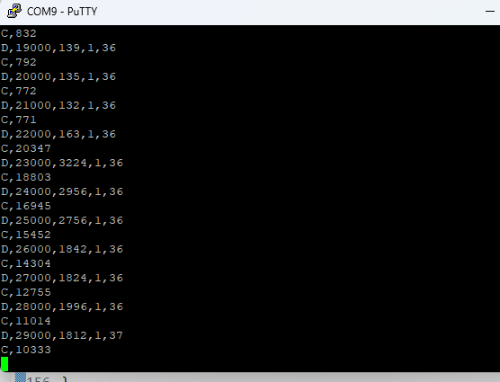
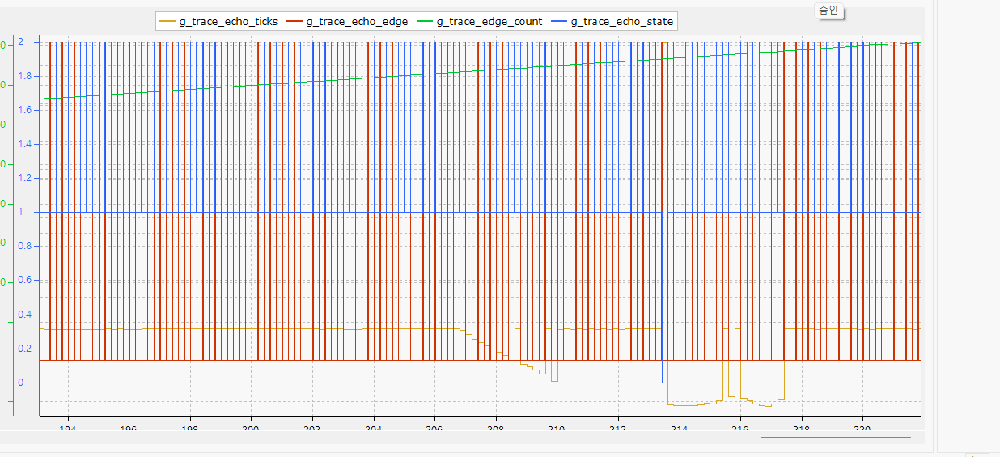
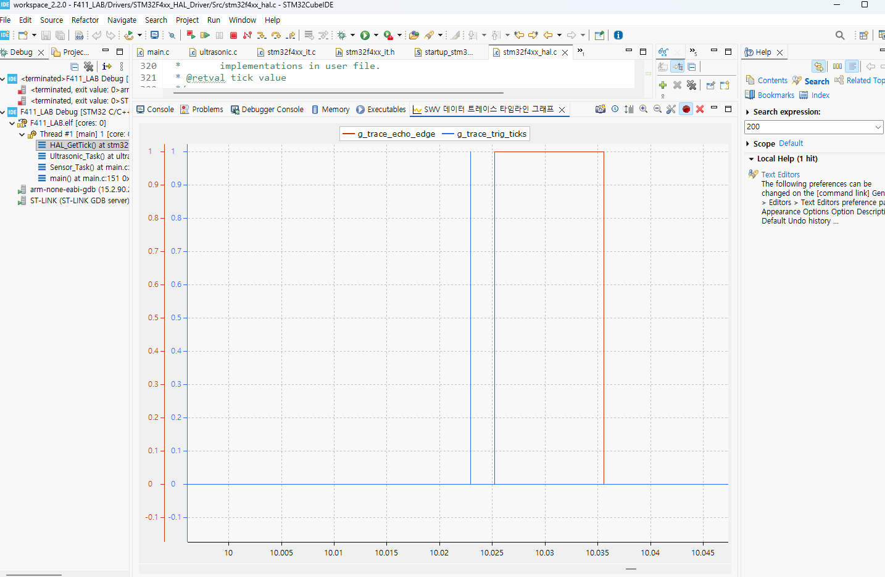
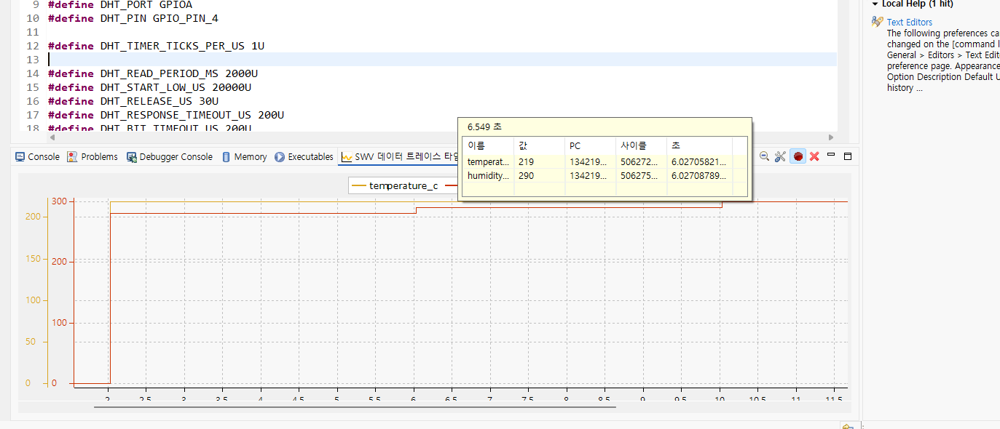
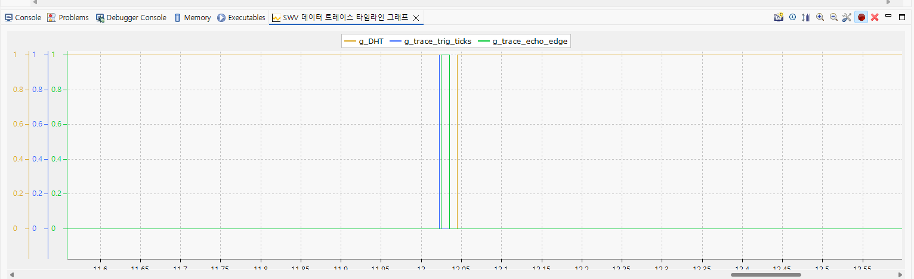

# F411_LAB

``` c언어
#include "ultrasonic.h"
#include "main.h"

extern TIM_HandleTypeDef htim1;

/* Echo 추적 변수 */
volatile uint16_t g_trace_echo_ticks;
volatile uint8_t g_trace_echo_edge;
volatile uint8_t g_trace_echo_state;
volatile uint32_t g_trace_edge_count;

/* Trig 추적 변수 */
volatile uint16_t g_trace_trig_ticks;
volatile uint8_t g_trace_trig_edge;
volatile uint8_t g_trace_trig_state;
volatile uint32_t g_trace_trig_edge_count;

/* Trig 종료 -> Echo 시작 응답 지연 시간 추적 변수 (추가됨) */
volatile uint16_t g_trace_trig_to_echo_ticks;

//#define US_SAMPLE_PERIOD_MS 200U
#define US_SAMPLE_PERIOD_MS 1000U
#define US_PUBLISH_PERIOD_MS 1000U
#define US_ECHO_TIMEOUT_MS 35U
#define US_TRIG_PULSE_US 10U
#define US_TIMER_TICKS_PER_US 1U
/* TRIG 이후 ECHO 상승까지 허용할 시간 범위 (센서 특성에 맞게 조정 가능) */
#define US_TRIG_TO_ECHO_MIN_TICKS    (100U * US_TIMER_TICKS_PER_US)   /* 최소 100us 이후 응답 인정 */
#define US_TRIG_TO_ECHO_MAX_TICKS    (2000U * US_TIMER_TICKS_PER_US)  /* 최대 2000us(2ms) 이내 응답 필수 */

#define US_MIN_ECHO_TICKS (100U * US_TIMER_TICKS_PER_US)
#define US_MAX_ECHO_TICKS (30000U * US_TIMER_TICKS_PER_US)

#define US_MIN_DISTANCE_MM 20U
#define US_MAX_DISTANCE_MM 4000U
#define US_FILTER_SIZE 5U
#define US_REFERENCE_SOUND_SPEED_X10 3430U
#define US_DEFAULT_SOUND_SPEED_X10 US_REFERENCE_SOUND_SPEED_X10
#define US_MIN_SOUND_SPEED_X10 2500U
#define US_MAX_SOUND_SPEED_X10 4000U

typedef enum {
    US_STATE_IDLE = 0,
    US_STATE_WAIT_ECHO
} Ultrasonic_State;

static TIM_HandleTypeDef *s_htim;
static volatile Ultrasonic_State s_state;
static uint32_t s_lastSampleTick;
static uint32_t s_lastPublishTick;
static uint32_t s_echoStartTick;
static uint16_t s_echoStartCnt;

static volatile uint16_t s_trigEndCnt;      /* Ultrasonic_Task -> OnEchoEdge 전달용 */
static volatile uint16_t s_echoWidthTicks;
static volatile uint8_t s_echoRising;
static volatile uint8_t s_echoDone;

static uint16_t s_samplesRef[US_FILTER_SIZE];
static uint16_t s_samplesCorr[US_FILTER_SIZE];
static uint8_t s_sampleCount;
static uint8_t s_sampleIndex;
static uint32_t s_errorCount;
static uint16_t s_soundSpeedX10;
static Ultrasonic_Result s_result;
static volatile uint8_t s_resultReady;

static uint16_t US_GetCounter(void);
static void US_StoreSample(uint32_t width_ticks);
static uint16_t US_Median(const uint16_t *samples);
static void US_Publish(uint32_t now);

static uint16_t US_GetCounter(void)
{
  return (uint16_t)__HAL_TIM_GET_COUNTER(s_htim);
}

void Ultrasonic_Init(void)
{
  s_htim = &htim1;
  HAL_GPIO_WritePin(TRIG_GPIO_Port, TRIG_Pin, GPIO_PIN_RESET);

  if (HAL_TIM_Base_Start(s_htim) != HAL_OK)
  {
    Error_Handler();
  }

  s_state = US_STATE_IDLE;
  s_lastSampleTick = HAL_GetTick();
  s_lastPublishTick = s_lastSampleTick;
  s_echoStartTick = 0U;
  s_echoStartCnt = 0U;

  s_echoWidthTicks = 0U;
  s_echoRising = 0U;
  s_echoDone = 0U;
  s_sampleCount = 0U;
  s_sampleIndex = 0U;
  s_errorCount = 0U;
  s_soundSpeedX10 = US_DEFAULT_SOUND_SPEED_X10;
  s_resultReady = 0U;
  s_result.timestamp_ms = 0U;
  s_result.distance_ref_mm = 0U;
  s_result.distance_mm = 0U;
  s_result.valid = 0U;
  s_result.errors = 0U;
  /* Echo 추적 변수 초기화 */
  g_trace_echo_ticks = 0U;
  g_trace_echo_edge = 0U;
  g_trace_echo_state = 0U;
  g_trace_edge_count = 0U;

  /* Trig 및 지연 시간 추적 변수 초기화 */
  g_trace_trig_ticks = 0U;
  g_trace_trig_edge = 0U;
  g_trace_trig_state = 0U;
  g_trace_trig_edge_count = 0U;
  g_trace_trig_to_echo_ticks = 0U;
}

void Ultrasonic_Task(void)
{
  uint32_t now;
  uint16_t trigStartCnt;
  uint16_t trigEndCnt;

  if (s_htim == NULL)
  {
    return;
  }

  now = HAL_GetTick();

  switch (s_state)
  {
    case US_STATE_IDLE:
      if ((now - s_lastSampleTick) >= US_SAMPLE_PERIOD_MS)
      {
        s_lastSampleTick = now;
        s_echoRising = 0U;
        s_echoDone = 0U;

        /* 1. TRIG Rising Edge 기록 */
        trigStartCnt = US_GetCounter();
        HAL_GPIO_WritePin(TRIG_GPIO_Port, TRIG_Pin, GPIO_PIN_SET);
        g_trace_trig_edge = 1U;
        g_trace_trig_state = 1U;
        g_trace_trig_ticks = 1U;
        g_trace_trig_edge_count++;

        while ((uint16_t)(US_GetCounter() - trigStartCnt) < US_TRIG_PULSE_US)
        {
        }

        /* 2. TRIG Falling Edge 및 펄스 폭 기록 */
        HAL_GPIO_WritePin(TRIG_GPIO_Port, TRIG_Pin, GPIO_PIN_RESET);
        trigEndCnt = US_GetCounter();
        s_trigEndCnt = trigEndCnt; /* OnEchoEdge에서 사용할 종료 카운터 저장 */

        g_trace_trig_ticks = 0U;
        g_trace_trig_edge = 0U;
        g_trace_trig_state = 0U;
        g_trace_trig_edge_count++;

        s_echoStartTick = now;
        s_state = US_STATE_WAIT_ECHO;
        g_trace_echo_state = 2U;
      }
      break;

    case US_STATE_WAIT_ECHO:
      if (s_echoDone != 0U)
      {
        if (s_echoDone == 1U)
        {
          US_StoreSample(s_echoWidthTicks);
        }
        else
        {
          s_errorCount++;
        }
        s_echoDone = 0U;
        s_state = US_STATE_IDLE;
      }
      else if ((now - s_echoStartTick) >= US_ECHO_TIMEOUT_MS)
      {
        s_errorCount++;
        s_state = US_STATE_IDLE;
        g_trace_echo_edge = 0U;
        g_trace_echo_state = 0U;
      }
      break;

    default:
      s_state = US_STATE_IDLE;
      break;
  }

  if ((now - s_lastPublishTick) >= US_PUBLISH_PERIOD_MS)
  {
    s_lastPublishTick = now;
    US_Publish(now);
  }
}

uint8_t Ultrasonic_GetResult(Ultrasonic_Result *result)
{
  if ((result == NULL) || (s_resultReady == 0U))
  {
    return 0U;
  }

  *result = s_result;
  s_resultReady = 0U;
  return 1U;
}

uint8_t Ultrasonic_IsIdle(void)
{
  return (s_state == US_STATE_IDLE) ? 1U : 0U;
}

void Ultrasonic_SetSoundSpeedX10(uint16_t speed_x10)
{
  if ((speed_x10 >= US_MIN_SOUND_SPEED_X10) && (speed_x10 <= US_MAX_SOUND_SPEED_X10))
  {
    s_soundSpeedX10 = speed_x10;
  }
}

uint16_t Ultrasonic_GetLastEchoTicks(void)
{
  return s_echoWidthTicks;
}

void Ultrasonic_OnEchoEdge(void)
{
  uint16_t now;
  uint16_t width;

  if (s_htim == NULL)
  {
    return;
  }

  now = US_GetCounter();

  if (HAL_GPIO_ReadPin(ECHO_GPIO_Port, ECHO_Pin) == GPIO_PIN_SET)
  {
    if ((s_state == US_STATE_WAIT_ECHO) && (s_echoRising == 0U))
    {
      s_echoStartCnt = now;
      s_echoRising = 1U;

      /* TRIG 종료 후 ECHO 상승까지 걸린 시간 계산 */
      g_trace_trig_to_echo_ticks = (uint16_t)(now - s_trigEndCnt);

      g_trace_echo_edge = 1U;
      g_trace_echo_state = 1U;
      g_trace_edge_count++;
    }
  }
  else if (s_echoRising != 0U)
  {
    width = (uint16_t)(now - s_echoStartCnt);
    s_echoRising = 0U;
    s_echoWidthTicks = width;
    g_trace_echo_ticks = width;
    g_trace_echo_edge = 0U;
    g_trace_echo_state = 0U;
    g_trace_edge_count++;

    if ((width >= US_MIN_ECHO_TICKS) && (width <= US_MAX_ECHO_TICKS))
    {
      s_echoDone = 1U;
    }
    else
    {
      s_echoDone = 2U;
    }
  }
}
static void US_StoreSample(uint32_t width_ticks)
{
  uint32_t width_us = width_ticks / US_TIMER_TICKS_PER_US;
  uint32_t distance_ref_mm = (width_us * US_REFERENCE_SOUND_SPEED_X10) / 20000U;
  uint32_t distance_mm = (width_us * s_soundSpeedX10) / 20000U;

  if ((distance_mm >= US_MIN_DISTANCE_MM) && (distance_mm <= US_MAX_DISTANCE_MM))
  {
    s_samplesRef[s_sampleIndex] = (uint16_t)distance_ref_mm;
    s_samplesCorr[s_sampleIndex] = (uint16_t)distance_mm;
    s_sampleIndex = (uint8_t)((s_sampleIndex + 1U) % US_FILTER_SIZE);
    if (s_sampleCount < US_FILTER_SIZE)
    {
      s_sampleCount++;
    }
  }
  else
  {
    s_errorCount++;
  }
}

static uint16_t US_Median(const uint16_t *samples)
{
  uint16_t sorted[US_FILTER_SIZE];
  uint8_t i;
  uint8_t j;

  for (i = 0U; i < s_sampleCount; i++)
  {
    sorted[i] = samples[i];
  }

  for (i = 0U; (uint8_t)(i + 1U) < s_sampleCount; i++)
  {
    for (j = (uint8_t)(i + 1U); j < s_sampleCount; j++)
    {
      if (sorted[j] < sorted[i])
      {
        uint16_t temp = sorted[i];
        sorted[i] = sorted[j];
        sorted[j] = temp;
      }
    }
  }

  return sorted[s_sampleCount / 2U];
}

static void US_Publish(uint32_t now)
{
  s_result.timestamp_ms = now;

  if (s_sampleCount > 0U)
  {
    s_result.distance_ref_mm = US_Median(s_samplesRef);
    s_result.distance_mm = US_Median(s_samplesCorr);
    s_result.valid = 1U;
  }
  else
  {
    s_result.distance_ref_mm = 0U;
    s_result.distance_mm = 0U;
    s_result.valid = 0U;
  }

  s_result.errors = s_errorCount;
  s_resultReady = 1U;
  

  s_sampleCount = 0U;
  s_sampleIndex = 0U;
}
```


-  거리측정 센서 와 TRIG와 ECHO 의 타이머를 맞춰서 본 결과와 PUTTY 로 본 결과 창이다. 두번째는 ECHO 만 있는것. 
 <br>
 <br>
 <br>

- 온습도 PUTTY 거랑 그래프 본것.
- 바꾼 DHT.C 온습도 그래프 볼려고 변수와 초기값해서 한 코드이다.
```
#include "dht.h"
#include "main.h"

extern TIM_HandleTypeDef htim1;


#define DHT_PORT GPIOA
#define DHT_PIN GPIO_PIN_4

#define DHT_TIMER_TICKS_PER_US 1U

#define DHT_READ_PERIOD_MS 2000U
#define DHT_START_LOW_US 20000U
#define DHT_RELEASE_US 30U
#define DHT_RESPONSE_TIMEOUT_US 200U
#define DHT_BIT_TIMEOUT_US 200U
#define DHT_ONE_THRESHOLD_US 50U

static uint32_t s_lastReadTick;
static uint32_t s_errorCount;
static Dht_Result s_result;
static volatile uint8_t s_resultReady;
volatile uint8_t g_DHT;

static void DHT_SetPinOutput(void);
static void DHT_SetPinInput(void);
static uint32_t DHT_NowUs(void);
static uint32_t DHT_ElapsedUs(uint32_t start);
static void DHT_DelayUs(uint32_t us);
static uint8_t DHT_WaitLevel(GPIO_PinState level, uint32_t timeout_us, uint32_t *duration);
static uint8_t DHT_ReadRaw(uint8_t *data);
static uint8_t DHT_Decode(const uint8_t *data, int32_t *temperature_c_x10, uint32_t *humidity_rh_x10);

void Dht_Init(void)
{
  GPIO_InitTypeDef gpio = {0};

  __HAL_RCC_GPIOA_CLK_ENABLE();

  gpio.Pin = DHT_PIN;
  gpio.Mode = GPIO_MODE_INPUT;
  gpio.Pull = GPIO_PULLUP;
  gpio.Speed = GPIO_SPEED_FREQ_HIGH;
  HAL_GPIO_Init(DHT_PORT, &gpio);

  s_lastReadTick = HAL_GetTick();
  s_errorCount = 0U;
  s_resultReady = 0U;
  s_result.timestamp_ms = 0U;
  s_result.errors = 0U;
  s_result.temperature_c_x10 = 0;
  s_result.humidity_rh_x10 = 0U;
  s_result.valid = 0U;

  g_DHT = 0U;

}

void Dht_Task(void)
{
  uint32_t now = HAL_GetTick();
  uint8_t data[5];
  int32_t temperature_c_x10;
  uint32_t humidity_rh_x10;
  uint8_t ok = 0U;

  if ((now - s_lastReadTick) < DHT_READ_PERIOD_MS)
  {
    return;
  }
  s_lastReadTick = now;

  DHT_SetPinOutput();
  HAL_GPIO_WritePin(DHT_PORT, DHT_PIN, GPIO_PIN_RESET);
  g_DHT= 0U;
  DHT_DelayUs(DHT_START_LOW_US);
  HAL_GPIO_WritePin(DHT_PORT, DHT_PIN, GPIO_PIN_SET);
  g_DHT=1U;
  DHT_DelayUs(DHT_RELEASE_US);
  DHT_SetPinInput();

  if (DHT_ReadRaw(data) != 0U)
  {
    uint8_t checksum = (uint8_t)(data[0] + data[1] + data[2] + data[3]);

    if (checksum == data[4])
    {
      if (DHT_Decode(data, &temperature_c_x10, &humidity_rh_x10) != 0U)
      {
        s_result.temperature_c_x10 = (int16_t)temperature_c_x10;
        s_result.humidity_rh_x10 = (uint16_t)humidity_rh_x10;


        s_result.valid = 1U;
        ok = 1U;
      }
    }
  }

  if (ok == 0U)
  {
    s_result.valid = 0U;
    s_errorCount++;
  }

  s_result.timestamp_ms = now;
  s_result.errors = s_errorCount;
  s_resultReady = 1U;
}

uint8_t Dht_GetResult(Dht_Result *result)
{
  if ((result == NULL) || (s_resultReady == 0U))
  {
    return 0U;
  }

  *result = s_result;
  s_resultReady = 0U;
  return 1U;
}

static void DHT_SetPinOutput(void)
{
  GPIO_InitTypeDef gpio = {0};

  gpio.Pin = DHT_PIN;
  gpio.Mode = GPIO_MODE_OUTPUT_OD;
  gpio.Pull = GPIO_PULLUP;
  gpio.Speed = GPIO_SPEED_FREQ_HIGH;
  HAL_GPIO_Init(DHT_PORT, &gpio);
}

static void DHT_SetPinInput(void)
{
  GPIO_InitTypeDef gpio = {0};

  gpio.Pin = DHT_PIN;
  gpio.Mode = GPIO_MODE_INPUT;
  gpio.Pull = GPIO_PULLUP;
  gpio.Speed = GPIO_SPEED_FREQ_HIGH;
  HAL_GPIO_Init(DHT_PORT, &gpio);
}

static uint32_t DHT_NowUs(void)
{
  return (uint32_t)(__HAL_TIM_GET_COUNTER(&htim1) / DHT_TIMER_TICKS_PER_US);
}

static uint32_t DHT_ElapsedUs(uint32_t start)
{
  return (uint16_t)(DHT_NowUs() - start);
}

static void DHT_DelayUs(uint32_t us)
{
  uint32_t start = DHT_NowUs();

  while (DHT_ElapsedUs(start) < us)
  {
  }
}

static uint8_t DHT_WaitLevel(GPIO_PinState level, uint32_t timeout_us, uint32_t *duration)
{
  uint32_t start = DHT_NowUs();

  while (HAL_GPIO_ReadPin(DHT_PORT, DHT_PIN) != level)
  {
    if (DHT_ElapsedUs(start) >= timeout_us)
    {
      return 0U;
    }
  }

  if (duration != NULL)
  {
    *duration = DHT_ElapsedUs(start);
  }

  return 1U;
}

static uint8_t DHT_ReadRaw(uint8_t *data)
{
  uint32_t duration;
  uint8_t i;
  uint8_t bit;

  for (i = 0U; i < 5U; i++)
  {
    data[i] = 0U;
  }

  if (DHT_WaitLevel(GPIO_PIN_RESET, DHT_RESPONSE_TIMEOUT_US, NULL) == 0U)
  {
    return 0U;
  }
  if (DHT_WaitLevel(GPIO_PIN_SET, DHT_RESPONSE_TIMEOUT_US, NULL) == 0U)
  {
    return 0U;
  }

  for (i = 0U; i < 40U; i++)
  {
    if (DHT_WaitLevel(GPIO_PIN_RESET, DHT_BIT_TIMEOUT_US, NULL) == 0U)
    {
      return 0U;
    }
    if (DHT_WaitLevel(GPIO_PIN_SET, DHT_BIT_TIMEOUT_US, NULL) == 0U)
    {
      return 0U;
    }
    if (DHT_WaitLevel(GPIO_PIN_RESET, DHT_BIT_TIMEOUT_US, &duration) == 0U)
    {
      return 0U;
    }

    bit = (duration > DHT_ONE_THRESHOLD_US) ? 1U : 0U;
    data[i / 8U] = (uint8_t)((data[i / 8U] << 1U) | bit);
  }

  return 1U;
}

static uint8_t DHT_Decode(const uint8_t *data, int32_t *temperature_c_x10, uint32_t *humidity_rh_x10)
{
  uint32_t humidity;
  int32_t temperature;

  humidity = ((uint32_t)data[0] << 8) | data[1];
  temperature = (int32_t)(((uint16_t)(data[2] & 0x7FU) << 8) | data[3]);
  if ((data[2] & 0x80U) != 0U)
  {
    temperature = -temperature;
  }

  if ((humidity <= 1000U) && (temperature >= -400) && (temperature <= 800))
  {
    *humidity_rh_x10 = humidity;
    *temperature_c_x10 = temperature;
    return 1U;
  }

  if ((data[1] <= 9U) && (data[3] <= 9U))
  {
    humidity = ((uint32_t)data[0] * 10U) + data[1];
    temperature = ((int32_t)data[2] * 10) + (int32_t)data[3];

    if ((humidity <= 1000U) && (temperature >= 0) && (temperature <= 800))
    {
      *humidity_rh_x10 = humidity;
      *temperature_c_x10 = temperature;
      return 1U;
    }
  }

  return 0U;
}
```
 <br>
 <br>
 <br>
